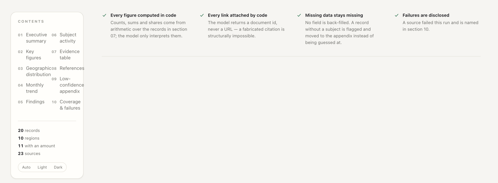
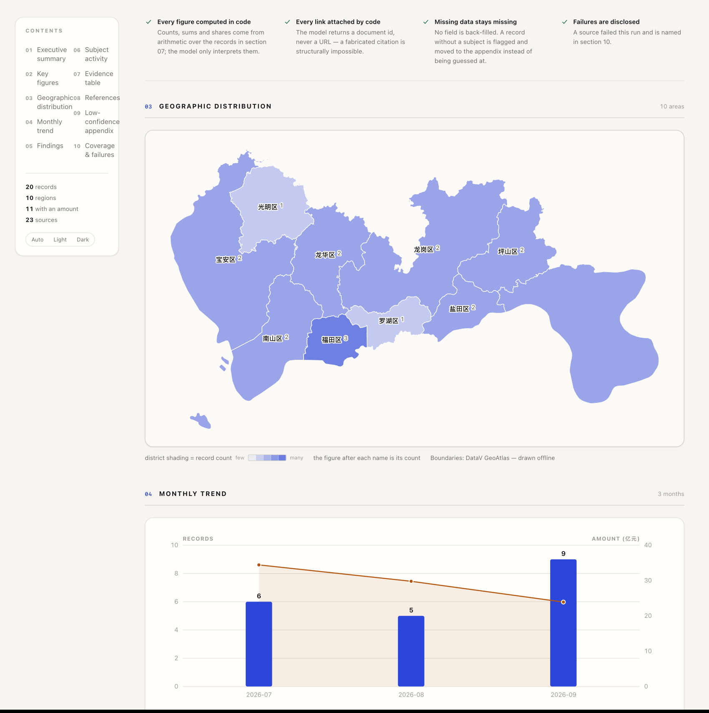
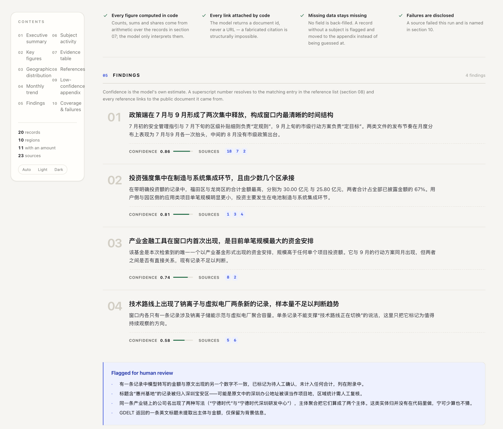
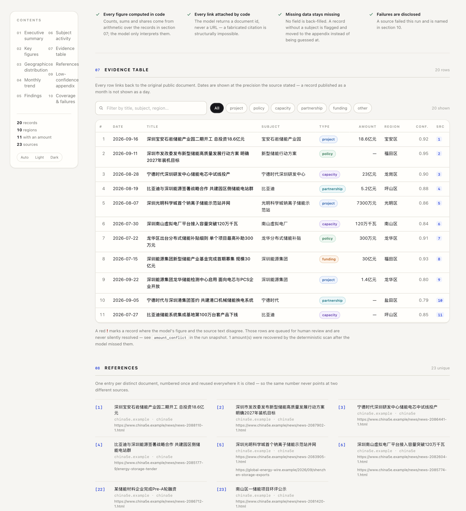
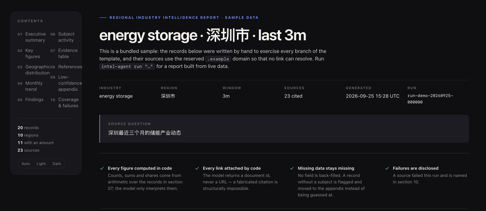
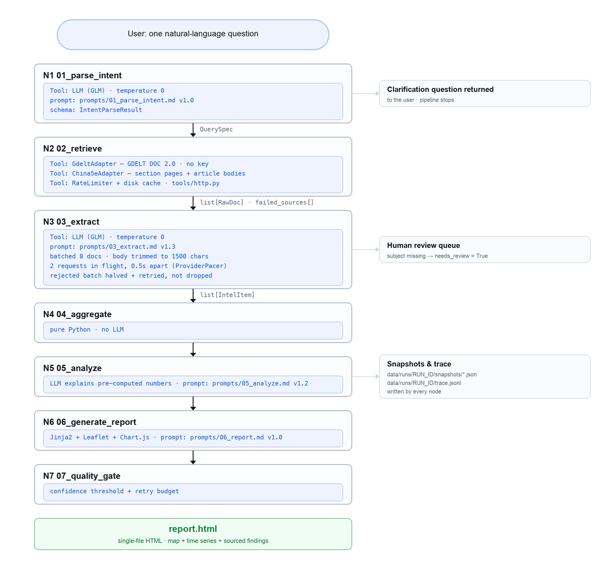

<div align="center">

# Sourced Intel

**One question in. One sourced, verifiable report out.**

A seven-node [LangGraph](https://github.com/langchain-ai/langgraph) pipeline that turns
*"what is happening in energy storage in Shenzhen over the last three months?"* into a
self-contained HTML report — where every figure is computed in code, every citation points
at a real document, and every failure is printed rather than hidden.

[](LICENSE)
[](#quickstart)
[](pyproject.toml)
[](#testing)
[](#the-report)

<br />



<sub>The real output. Every screenshot in this README is rendered from the template in
[`examples/demo-report.html`](examples/demo-report.html) — nothing is mocked up.</sub>

</div>

---

## Try it in 30 seconds

```bash
pip install -r requirements.txt
python3 scripts/demo.py            # writes examples/demo-report.html
```

That renders a complete report from bundled sample data. **The demo itself makes no HTTP
request and needs no API key** — `examples/demo-report.html` in this repo *is* that
command's output, so you can also just open that file.

To run it against live sources you need a [Zhipu GLM](https://open.bigmodel.cn) key
(the free tier is enough):

```bash
python3 scripts/preflight.py       # checks the key, the config and every source
cp .env.example .env               # then set GLM_API_KEY
python3 -m venv .venv && source .venv/bin/activate
pip install -e .                   # gives you the `sourced-intel` command
sourced-intel run "深圳最近三个月的储能产业动态"
```

<details>
<summary>Or with Docker, if you would rather not install a Python toolchain</summary>

```bash
cp .env.example .env      # REQUIRED first: both services declare env_file: .env
docker compose up --build
#   demo UI   http://localhost:8501
#   REST API  http://localhost:8000/docs
```

</details>

---

## Why this is not just another "LLM writes a report" wrapper

The hard part of automated research is not generating prose. It is making the output
**checkable**. Three rules run through the whole codebase, and each one is enforced by
structure rather than by asking the model nicely:

| Rule | How it is enforced |
|---|---|
| **The model never supplies a URL** | The schema the model fills in has no `source_url` field at all — it returns a `doc_id`, and the real URL is re-attached from our own document table. A fabricated citation is not unlikely; it is *unrepresentable*. |
| **The model never does arithmetic** | Counts, sums, shares and groupings are computed in `nodes/aggregate.py`. The analysis prompt receives pre-computed figures and is told every number must appear verbatim in its input. Below five records the system refuses to conclude anything at all, and says so. |
| **Missing data stays missing** | No field is back-filled. A record with no subject is flagged `needs_review` and moved to an appendix instead of being guessed at. A date published as a month is never rendered as the 1st of that month. |

And one rule about the report itself:

> **Failures are disclosed, not hidden.** The report ends with a *Coverage & failures*
> section naming every source that failed or degraded. A pipeline that silently drops a
> source is worse than one that admits it.

---

## The report

A single HTML file — no build step, no asset directory, forwardable by email.

<table>
<tr>
<td width="50%"></td>
<td width="50%"></td>
</tr>
<tr>
<td><sub><b>The map and the chart are inline SVG.</b> Both are drawn by the browser with no script and no CDN request, so they survive a lost network and print correctly. Leaflet upgrades the map to interactive tiles only if it loads.</sub></td>
<td><sub><b>One source, one number.</b> Each distinct URL gets a citation number once, shared by the findings and the evidence table, and resolved in a reference list. The same number never points at two documents.</sub></td>
</tr>
<tr>
<td></td>
<td></td>
</tr>
<tr>
<td><sub><b>The evidence table is server-rendered</b>, so it works with JavaScript off; the search box, type chips and row counter are an enhancement layered on top.</sub></td>
<td><sub><b>Light and dark from one set of tokens.</b> The theme is applied before first paint, so there is no flash of the wrong colours when a report is opened from disk.</sub></td>
</tr>
</table>

---

## How it works



```
question
   │
   ├─① parse_intent ──── LLM + JSON schema ──────────► QuerySpec
   │                                                    │
   ├─② retrieve ──────── GDELT + china5e (concurrent) ─► list[RawDoc] + failed_sources
   │                                                    │
   ├─③ extract ───────── LLM, batched ×8, concurrent ──► list[IntelItem]
   │                                                    │
   ├─④ aggregate ─────── pure Python, no LLM ──────────► region / month / type buckets
   │                                                    │
   ├─⑤ analyze ───────── LLM interprets given numbers ─► findings + evidence URLs
   │                                                    │
   ├─⑥ generate_report ─ Jinja2 + inline SVG ──────────► report.html
   │                                                    │
   └─⑦ quality_gate ──── threshold + retry budget ─────► QualityReport
```

Full node contracts, prompt versions and worked I/O examples: **[`docs/workflow.md`](docs/workflow.md)**.

### Data sources

| Source | Role | What it actually returns |
|---|---|---|
| **GDELT DOC 2.0** | breadth (global news) | `url, title, seendate, domain, language, sourcecountry` — **headline only, no body** |
| **china5e.com** | depth (industry news) | title + publish time + attribution + **full article body**, 40 items/page |
| **DataV GeoAtlas** | geographic baseline | district GeoJSON with `adcode / name / centroid / geometry` |

> Picking these took a connectivity audit rather than a reading of the brief: three sources
> named in the original spec are dead — a hijacked DNS record, a retired domain, and two
> JS-only shells. The evidence is in [`docs/PITFALLS.md`](docs/PITFALLS.md).

**Degradation is a feature, not an accident.** GDELT rate-limits shared IPs to roughly one
successful request every 20–40 seconds, so it is treated as optional: one attempt per run,
a 30-minute disk cache, and if it fails the report is still produced and the failure is
disclosed. Two sources that fail differently are worth more than one that always works.

---

## Engineering notes

### The four requirements this was built against

| Requirement | Implementation | Verify with |
|---|---|---|
| **State snapshot** | `state.py::save_snapshot`, wrapper in `graph.py` | `ls data/runs/<run_id>/snapshots/` |
| **Fault tolerance** | per-node `try/except`, bounded retries, batch halving | break a source; the run still completes |
| **Tracing** | `tracing.py` → `trace.jsonl` | `cat data/runs/<run_id>/trace.jsonl` |
| **Context trimming** | `state.py::NODE_STATE_SLICES` (allow-list per node) | `node_payload_stats()` |

### Things that were harder than they should have been

Most of the real work was in failure modes that only show up under load. All of them are
written up with a reproduction command in **[`docs/PITFALLS.md`](docs/PITFALLS.md)** — 37
entries, each one something that was actually observed rather than imagined:

- **A swallowed exception that looked like success.** `render_html` falls back to Markdown
  on any template error, which is good runtime behaviour and terrible failure behaviour:
  one missing key silently turned "the formatted report" into "a plain Markdown file" and
  the run still reported `completed`. Now recorded as a `html_render_fallback` trace event.
- **A concurrency ceiling that was a data-loss bug in disguise.** Raising
  `GLM_MAX_CONCURRENCY` did make runs *look* faster — because failed batches were being
  dropped whole. The extract node now halves a rejected batch (8 → 4 → 2 → 1) and retries
  it. The measured ceiling is **2 concurrent requests**; ten runs per configuration put 3
  in flight at 4–5 successes out of 10 regardless of spacing.
- **A test tool that reported success without running the tests.** The sandbox's
  `sitecustomize.py` shim intercepted `mkdir`/`unlink`, so `python -m pytest` reported
  127 passed + 48 errors while `python -E` reported 175 passed. A tool chain's view of the
  world is not the file system.

### Testing

```bash
pytest tests/ -m "not slow" -q     # 287 tests, ~2 s, no network, no credential
python3 -m unittest discover -s tests -p "test_parsing.py"   # 58 tests, stdlib only
```

The suite is split deliberately:

- **Zero-install.** The parsing layer, the amount/date reconciliation and the source
  adapters are tested with `unittest` and the standard library alone. CI runs this in a job
  that installs *nothing* — if the claim ever stops being true, that job fails.
- **Offline.** 287 tests covering the pipeline nodes with a stubbed provider, the report
  contract (section numbering, citation registry, date precision, HTML escaping), the
  demo fixture's internal consistency and the CLI.
- **`slow`.** One live end-to-end run against the real API, excluded from CI by an explicit
  marker so a new unmarked test fails loudly instead of being silently skipped.

### Reproducing the performance numbers

`scripts/run_stats.py` reads the traces the pipeline already writes and prints a
distribution rather than a headline figure:

```bash
python3 scripts/run_stats.py --exclude 205122   # one run, named, excluded by hand
```

Across the ten runs recorded at the time of writing: **41–110 s total, median 61 s**. The
spread is entirely external — the crawl (0.9–42.5 s), extraction (7.5–33.5 s across three
sequential waves) and a single analysis call whose latency swings fourfold. Any single
figure, including these, is an anecdote. A `markdown fallbacks` line in the output **must
read 0**.

---

## Quickstart, in full

### Option A — Docker (recommended on Windows)

```bash
cd sourced-intel
cp .env.example .env          # then set GLM_API_KEY
docker compose config --quiet && echo "compose config OK"
docker compose up --build
```

The `cp` is not optional: both services declare `env_file: .env`, so a missing file makes
Compose stop *before* it builds anything.

### Option B — local

```bash
# 0. two diagnostics that install nothing at all, and tell you *why* something is broken
python3 scripts/preflight.py                 # env, config, credential, every source
python3 scripts/rehearse_glm.py --docs 3     # the real chain: fetch → parse → prompt → GLM

python3 -m venv .venv && source .venv/bin/activate
pip install -e ".[ui,api]"
cp .env.example .env                         # then set GLM_API_KEY

python3 scripts/demo.py                      # render the sample report (no key needed)
sourced-intel run "深圳最近三个月的储能产业动态"   # a real run
sourced-intel stats                            # summarise the runs you have made
```

On Windows the two zero-install diagnostics work as written; only the slashes change
(`python scripts\preflight.py`). Everything else is identical — all file I/O is explicitly
UTF-8, so Chinese text renders correctly even on a default (GBK) console.

### Where the results go

```
data/runs/run-20260918-.../
├── report.html      single file: map + charts + findings + evidence + references
├── trace.jsonl      one line per node: duration, model, prompt version, tokens
└── snapshots/       full state after every node, plus 99_final
```

### Exposing the API

Both ports in `docker-compose.yml` are published on `127.0.0.1`, and `sourced-intel api`
defaults to `--host 127.0.0.1`. That default is deliberate: the API has **no
authentication**, and every `POST /runs` spends real LLM quota, so binding it to `0.0.0.0`
would let anyone on the same network drain the account with one loop. The same applies to
the Streamlit UI, which calls the pipeline directly.

If you do want it reachable from another machine, the port binding is the easy part and the
rest is on you: put an authenticating reverse proxy in front of it, add rate limiting and a
concurrency ceiling, and cap spend at the provider. Run ids are validated against
`run-[A-Za-z0-9][A-Za-z0-9._-]*` and confined to `data/runs`, so a caller cannot use one to
write outside it - but that is the only hardening the service currently ships with.

`GET /health` reports the configuration with the API key as `set`/`unset` only. It is safe
to expose; the rest of the API is not.

---

## Project layout

```
sourced-intel/
├── src/sourced_intel/
│   ├── cli.py                    `sourced-intel` entry point (demo / run / stats / preflight)
│   ├── demo.py                   the bundled offline sample, and why it exists
│   ├── parsing.py                dependency-free text, amount and date parsing
│   ├── schemas.py                Pydantic v2 models — the contract the LLM fills in
│   ├── graph.py, state.py, tracing.py, llm.py, api.py, config.py
│   ├── nodes/                    the seven pipeline nodes
│   ├── prompts/                  ★ the prompt files, versioned by filename
│   ├── tools/                    HTTP client, HTML parser, source adapters
│   └── report/                   Jinja2 template + renderer + inline SVG map/chart
├── app/streamlit_app.py          demo UI
├── scripts/
│   ├── preflight.py              stdlib-only environment + source check
│   ├── rehearse_glm.py           stdlib-only live run of the real chain
│   ├── run_stats.py              reproduces the performance distribution
│   └── check_sources.py          proves each source is reachable
├── tests/                        zero-install, offline and live suites
├── examples/demo-report.html     ← the output of `sourced-intel demo`, committed
└── docs/
    ├── workflow.md               ★ full workflow: node contracts, prompts, I/O
    ├── architecture.md           component and data-flow detail
    ├── PITFALLS.md               37 verified pitfalls, each with a repro command
    ├── DEVELOPMENT_LOG.md        round-by-round build log
    ├── productization.md         the path from demo to product
    ├── ai_usage.md               how AI was used, and how its output was verified
    └── screenshots/              the images in this README
```

---

## Configuration

Every value can be set in `.env` or as a real environment variable; `Settings.redacted()`
prints the effective configuration without ever leaking the key.

| Variable | Default | Notes |
|---|---|---|
| `LLM_PROVIDER` | `glm` | `glm` (Zhipu, OpenAI-compatible) or `ollama` (local fallback) |
| `GLM_API_KEY` | — | **required** for `glm`; must contain a dot. `./scripts/preflight.py` tells you if it does not |
| `GLM_MODEL` | `glm-4.7` | **verify against `GET /models`** — a wrong name returns a misleading `429 code 1305` |
| `GLM_THINKING` | `off` | `off` closes the reasoning channel where the model allows it; the client downgrades to `low` by itself on models that always think |
| `GLM_MAX_CONCURRENCY` | `2` | measured ceiling on the free tier — see PITFALLS #32–#34 |
| `OLLAMA_MODEL` | `qwen3.5:4b` | offline fallback |
| `CONFIDENCE_THRESHOLD` | `0.6` | below this, a record moves to the appendix |
| `EXTRACT_BATCH_SIZE` | `8` | documents per extraction call |
| `NODE_MAX_RETRIES` | `2` | retry budget per node |

---

## Limitations, stated plainly

- **GDELT is unreliable by design.** One attempt per run, disk cache, graceful degradation.
  It contributes headlines only, and amount extraction on English headlines mostly fails.
- **Article bodies come from one source.** Baidu-family pages — a large share of GDELT's
  Chinese results — block automated fetches.
- **Region mapping is a 32-entry hand-curated table.** Unknown regions fall back to the
  query region and are counted as `unmapped_items` so the gap is visible.
- **No entity resolution.** If a source writes "宁德时代" and another writes "宁德时代深圳
  研发中心", they are two subjects. The report flags this in *Flagged for human review*
  rather than merging them on a guess.
- **The base map tiles need network on first open.** Everything else in the report —
  including the choropleth itself — is self-contained.

---

## Built with AI, and checked

This project was built with an AI coding assistant. The interesting part is not the
generation, it is the division of labour:

- **The assistant** probed every public data source with real HTTP requests and reported
  raw response fields; drafted the module skeleton, prompts and report template; wrote test
  fixtures from live pages.
- **The human** decided which sources survived the audit, caught the source-priority
  mistake (GDELT is rate-limited and returns no article body, so it could not carry the
  latency target), chose the provider, and set every acceptance criterion.
- **The verification loop** — re-checking the assistant's claims with `curl` before writing
  any parsing code, unit-testing against verbatim page fixtures, and rejecting a source
  plan built from the brief instead of from measurements — is documented in
  [`docs/ai_usage.md`](docs/ai_usage.md).

---

## License

[MIT](LICENSE).
